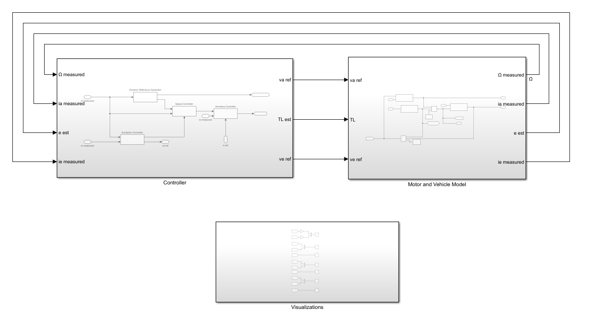
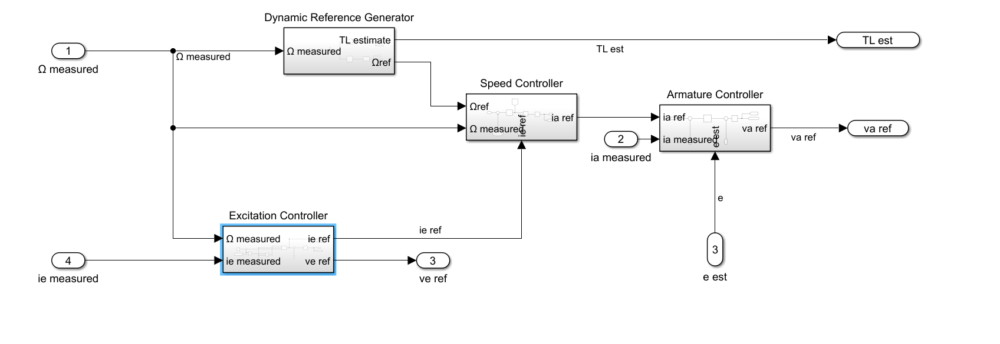
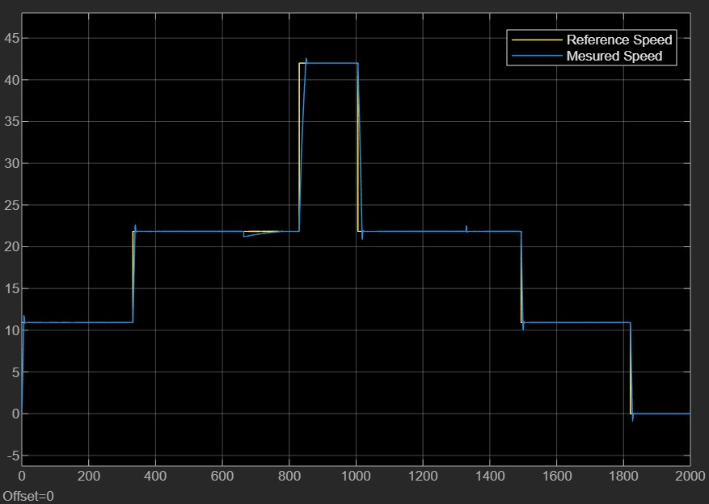
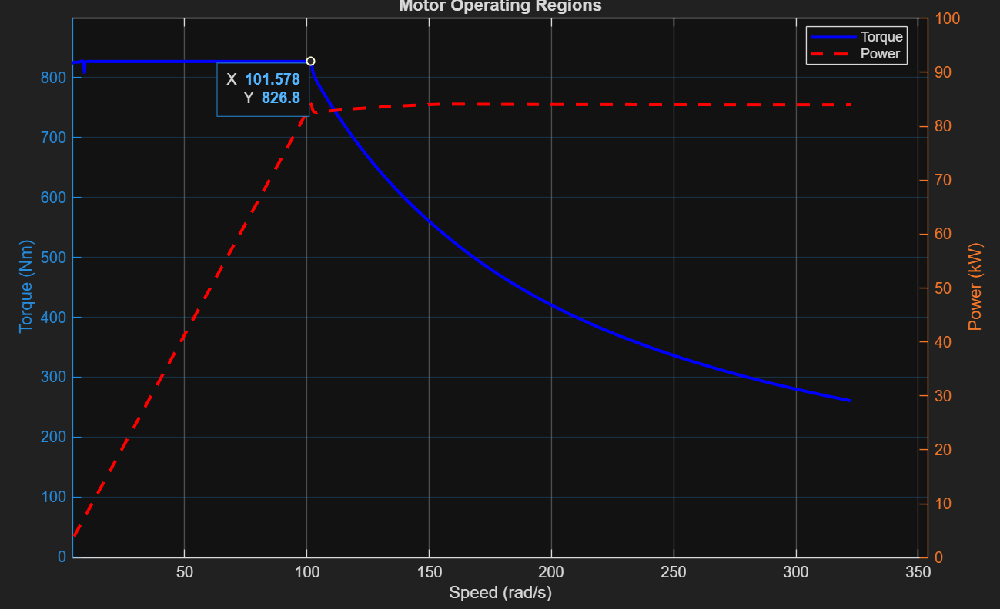

# DC motor drive for a tram (Simulink)

Control of a separately excited DC traction motor for the "Carelli 1928" tram: a 25.4 t vehicle on a 600 V line, driven over a 10 km route with speed changes and ±5% slopes. Course project for *Dynamics of Electrical Machines and Drives* at Politecnico di Milano (2025, course grade 30/30).

## Control structure

- **Reference generator:** turns the route (speed limits and slope versus distance) into a speed reference and an estimate of the load torque.
- **Speed controller:** outer PI loop, tuned with `pidtune` on a simplified plant (current loop as a 10 ms first-order lag, flux constant, rotor inertia and friction) for about 2 rad/s bandwidth. Its output is the armature current reference.
- **Armature controller:** inner current loop that sets the armature voltage, compensating the estimated back-EMF.
- **Excitation controller:** holds rated field current up to rated speed, then weakens the field so the tram can reach 42 km/h above the motor's rated 970 rpm.

## Results

The drive tracks the route's speed profile, including the steps and the slope sections:

Torque and power against speed show the two operating regions: constant torque (about 827 Nm) up to rated speed, then constant power (about 84 kW) in field weakening.

## Running it

Open MATLAB in this folder and run `setup_params.m`. It loads the tram and motor parameters and the route profile, tunes the speed PI, runs `model.slx`, and plots the operating regions.
